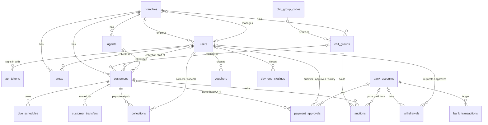
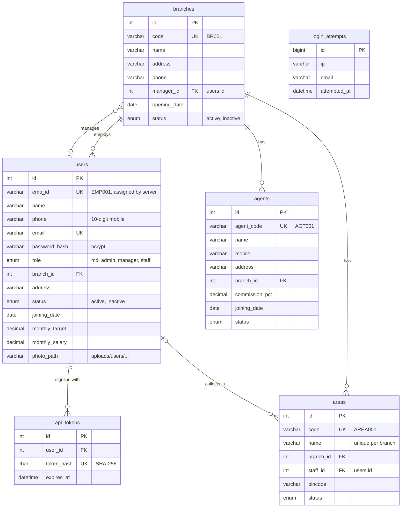
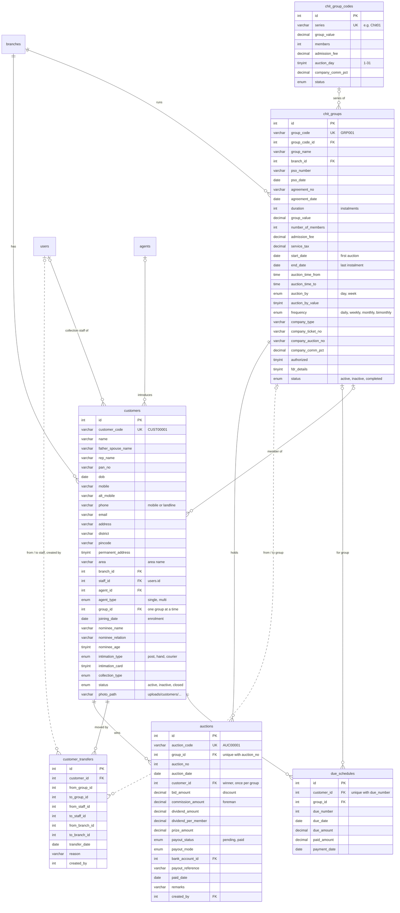
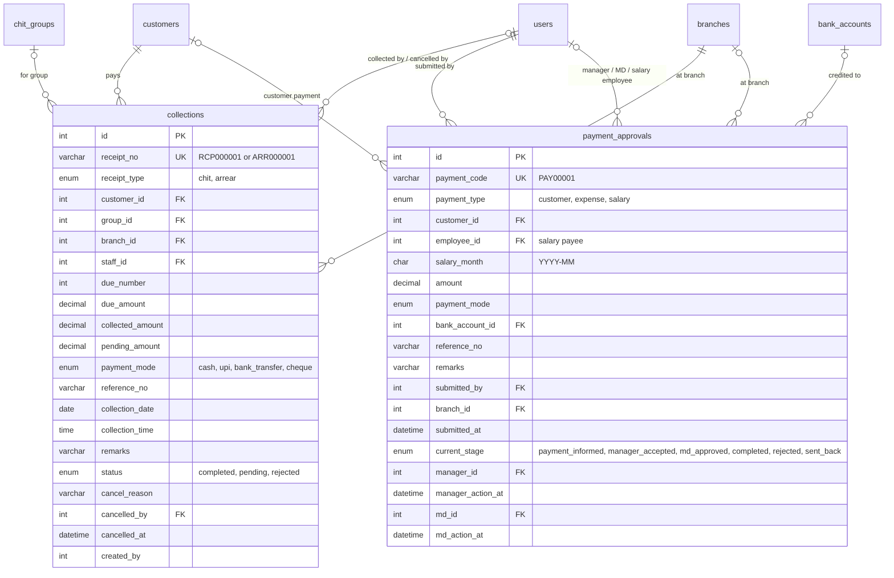
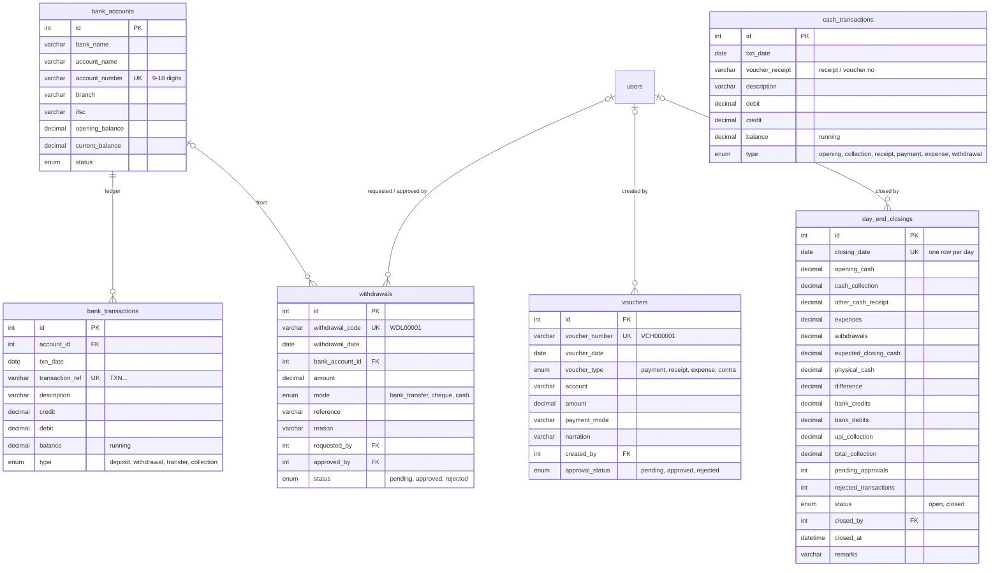

# Sabari Thendral — Finance Collection Management

A chit-fund / finance collection ERP: branches, staff, agents, areas, customers, chit groups, due schedules, chit and arrear (AR) receipts, bids (auctions) with dividends and a Bid Payments approval workflow with document upload, chit settlements, a three-step payment approval workflow, expenses, cash & bank books, day-end reconciliation, a mobile collection app for staff and agents (route map, cash handover), a separate Super Admin (MD) panel, subscriber enquiry, reports, login history and an audit trail.

```
frontend/   React 18 + TypeScript + Vite + Tailwind (single-page app)
backend/    PHP 8.1+ REST API (no framework, no Composer; PDO/MySQL)
database/   MySQL/MariaDB schema and demo data
```

## Requirements

- PHP 8.1+ with `pdo_mysql`
- MySQL 5.7+ or MariaDB 10.4+
- Node.js 18+

XAMPP covers PHP and MariaDB.

## Setup

### 1. Database

Start MySQL (XAMPP Control Panel → MySQL → Start), then:

```bash
mysql -u root -p < database/schema.sql            # creates the `fincollect` database
mysql -u root -p fincollect < database/seed.sql   # optional demo data
```

With XAMPP you can also import both files in phpMyAdmin (schema first).

Upgrading an existing database? Run each migration in `database/migrations/` it doesn't have yet, in order, once:

```bash
mysql -u root -p fincollect < database/migrations/001_masters_receipts_auctions.sql   # agents, areas, AR receipts, auctions
mysql -u root -p fincollect < database/migrations/002_receipt_cancellation.sql        # receipt cancellation
mysql -u root -p fincollect < database/migrations/003_salary_payments.sql             # employee salaries
mysql -u root -p fincollect < database/migrations/004_subscriber_details.sql          # subscriber KYC, nominee, intimation
mysql -u root -p fincollect < database/migrations/005_group_codes.sql                # chit group codes, full group details
mysql -u root -p fincollect < database/migrations/006_user_photos.sql                # user profile photos
mysql -u root -p fincollect < database/migrations/007_login_security.sql             # sign-in brute-force protection
mysql -u root -p fincollect < database/migrations/008_nominee_mobile.sql             # nominee mobile number
mysql -u root -p fincollect < database/migrations/009_expenses_receipt_bank.sql      # expenses, bank / UPI details on receipts
mysql -u root -p fincollect < database/migrations/010_staff_debit_denomination_location.sql  # staff debits, cash denominations, GPS on receipts, live location
mysql -u root -p fincollect < database/migrations/011_agent_login.sql                # agents can sign in to the collection app
mysql -u root -p fincollect < database/migrations/012_cash_handovers.sql             # cash handed over by staff / agents
mysql -u root -p fincollect < database/migrations/013_customer_location.sql          # customer map location
mysql -u root -p fincollect < database/migrations/014_chit_settlements.sql           # chit settlement requests and payouts
mysql -u root -p fincollect < database/migrations/015_bid_payments.sql               # Bid Payments workflow
mysql -u root -p fincollect < database/migrations/016_bid_payment_files.sql          # documents uploaded for bid payments
```

If the `mysql` client refuses to connect with a `caching_sha2_password` error, import the same files in phpMyAdmin instead.

A fresh install from `schema.sql` already includes every migration.

### 2. Backend

```powershell
Copy-Item backend/config/config.example.php backend/config/config.php
# Edit DB host/user/password and time zone in backend/config/config.php if needed
php -S 127.0.0.1:8000 -t backend/public backend/public/index.php
```

In Command Prompt, use `copy backend\config\config.example.php backend\config\config.php`
instead of `Copy-Item`.

On Windows with XAMPP, `php` may not be on the PATH; use its full path, from the project folder:

```bash
d:\xampp\php\php.exe -S 127.0.0.1:8000 -t backend/public backend/public/index.php
```

Keep this terminal open while you use the app — the frontend cannot sign in without it.

Check it: <http://127.0.0.1:8000/api/health> → `{"status":"ok"}`.
If `config.php` is missing, the example file is used (root / no password / port 3306, the XAMPP defaults).

### 3. Frontend

```bash
cd frontend
npm install
npm run dev
```

Open <http://localhost:5173>. The Vite dev server forwards `/api` to the backend on port 8000. To use another address, set `VITE_PROXY_TARGET` in `frontend/.env` (see `.env.example`).

## Demo accounts

All seeded users have the password `password`.

| Role              | Email               | Can do |
|-------------------|---------------------|--------|
| Managing Director | `rajesh@fincol.in`  | Everything; final payment approval; withdrawals; day close override |
| Admin             | `suresh@fincol.in`  | Users, branches, bank accounts, settings, day close |
| Manager           | `priya@fincol.in`   | Customers, groups, transfers, vouchers; first-step payment acceptance |
| Collection staff  | `anand@fincol.in`   | Own collection route, collections, payment submissions |

There is **one sign-in page for everyone**. It takes an email, or the Super Admin **Login ID**:

- **Super Admin (MD)** signs in with the Login ID and password set under Super Admin → User Management → Super Admin credentials, and lands in the **Super Admin Panel** (`/super-admin`). The panel has its own top bar with tabs Overview, Chit Settlements, Bid Approvals and User Management, a notification bell, and an **Admin Panel** button to look at the main app (a gold bar there leads back).
- **Admin, Manager** land on the Admin panel (`/dashboard`).
- **Collection staff and agents** land on the collection app (`/collect`). An agent gets a login when an email and password are entered for them in Users → Agents.

These accounts exist only if you loaded `seed.sql`. On the dev server (`npm run dev`) the sign-in page has a **Demo login** button that fills in the MD account; a production build (`npm run build`) leaves it out. Before going live, change these passwords or delete the users.

## Menu

The sidebar is grouped into sections. Items a role cannot use are hidden.

| Section | Items |
|---|---|
| Master Data | Customers (Add, List, Transfer), AR Subscribers, Chit Groups (Create, List, Group-wise Customers) |
| Company | Company Profile, Login History, Setup (Branch, Commission), Users (All Users, Admin, Agents, Areas — Managers see only Agents and Areas) |
| Transaction Data | AR Receipt, Chit Receipt, Expenses, Bid Payments, Payment (Entry, Voucher, Approval, Chit Settlement), Collections (Today, Statement, Summary) |
| System Enquiry | Subscriber Payments, Subscriber Profile |
| Master Report | Master Report, All Reports, Pending, Statements |
| Account Data | Cash & Bank, Day End |
| Auditing Data | Audit Log, Notifications |

"AR" means arrears throughout: installments past their due date and still unpaid. AR Subscribers lists every subscriber with all the details from the Add Subscriber form and their arrears; set **Show → In arrears only** to see just the overdue ones. An AR Receipt collects arrears.

On phones and tablets (narrower than 1024 px) the sidebar is a slide-in menu opened with the ☰ button in the top bar; on laptops and desktops it stays docked and can be collapsed to icons.

## Backend structure

```
backend/
  public/index.php     front controller: CORS, auth check, routing, JSON errors
  routes.php           every endpoint → Controller::method
  config/              database and app settings
  src/
    Core/              framework pieces: Router, Request, Input (validation), Auth, DB, HttpException
    Controllers/       one per resource; permissions, input validation and the HTTP response
    Models/            one per table; all SQL lives here
    Services/          business logic shared by controllers: Ledger (dues, receipts, cash & bank books),
                       Audit, Notifier, Photos, LoginThrottle, PasswordPolicy,
                       Visibility (what each role may receive)
```

- **Models** extend `Models\Model`. Each declares its table and an API-shaped `SELECT`, and gets `all()`, `find($id)`, `record($id)` (raw row), `create()`, `update()`, `delete()`, `exists()` and `nextCode()`. Table-specific queries are named methods on the model (e.g. `DueSchedule::unpaidForUpdate()`, `Payment::salaryTaken()`). `DashboardReport` holds the cross-table dashboard figures.
- **Controllers** contain no SQL; they call models and services.
- **Services** hold rules that touch several tables. For example, `Ledger::collect()` applies a receipt to dues, writes the receipt and posts cash.
- **Input validation** lives in `Core\Input` (see [Validation](#validation)); controllers call its typed getters (`num`, `int`, `percent`, `name`, `mobile`, `phone`, `pincode`, `pattern`, `reference`, …) and `validate()` reports every bad field at once.

## Frontend structure

```
frontend/src/
  App.tsx              routes
  pages/               one file per screen (some files hold several related screens)
  components/          Layout, Sidebar, Header, DataTable, Modal, FormControls (Input, PhoneInput,
                       Select, Dropdown, FilterBar…), SubscriberForm, CollectionForm, PhotoInput
  context/             AppContext (signed-in user, sidebar state), DataContext (all app data),
                       ToastContext
  hooks/               useForm (form state + API submit), usePrinting, useMediaQuery, …
  lib/                 api client, formatting, validation rules, brand name
  index.css            Tailwind, plus the print stylesheet
```

## How it works

- **Auth**: `POST /api/auth/login` returns a bearer token. Tokens are stored hashed in `api_tokens` and expire after `token_ttl_hours`. The app keeps the token in `localStorage` and restores the session on reload.
- **Data loading**: after sign-in the app calls `GET /api/bootstrap` once to load everything it shows, then re-fetches after each change. Per-resource endpoints exist too (see `backend/routes.php`).
- **Customers & dues**: adding a customer to a group generates the installment schedule as (group value ÷ members) over the group's duration, at the group's frequency. Due status (paid / partially paid / overdue / due today / upcoming) is derived from amounts and dates, so it never goes stale.
- **Customer status**: an Active customer is shown as **Inactive** once their oldest unpaid due is 5 days overdue (daily groups), 10 days (weekly) or 15 days (monthly / bi-monthly). It is worked out from the dues, so paying the overdue amount makes them Active again; they can still be collected from meanwhile. A status set by hand (Inactive / Closed) in Edit Customer is kept as is.
- **Collections**: an amount is applied to the oldest pending due first, and any excess carries forward. Cash collections post to the cash book.
- **Receipts**: a Chit Receipt is a regular installment (`RCP…`). An AR Receipt (`ARR…`) collects arrears only — installments past their due date — and cannot exceed them. MD/Admin can cancel a wrongly entered receipt (with a reason): only a customer's latest receipt can be cancelled, its amount goes back onto their dues, and a cash receipt gets a reversing entry in today's cash book. Cancelled receipts are excluded from every total and listed separately. Receipts created by an approved payment cannot be cancelled this way.
- **Salaries**: each user has a monthly salary (Users). A Salary payment picks the employee and month; the form shows the salary, what's paid and awaiting approval for that month, and fills in the balance. The API refuses more than the month's balance. Only MD, Admin and Managers can enter salary payments; they follow the normal approval workflow and post to cash or bank on MD approval.
- **Vouchers**: MD/Admin vouchers are approved on entry. Manager vouchers wait until an MD or Admin approves or rejects them; approved cash vouchers post to the cash book on the approval date.
- **Bids (auctions)**: recorded with **New Bid** on the Bid Payments page. The office enters the **prize to the winner**; the bid (discount) is worked out as group value − prize and must lie between the foreman commission and the maximum bid (Commission Setup). The commission comes out of the bid; the rest is a dividend that reduces every member's dues from that installment on. Recorded bids cannot be edited. The **Bid Register** tab lists them all.
- **Bid Payments** (`BP00001`): the prize is paid through **Apply → Verify → Approval (MD) → Document → Document Verify (MD) → Payment Entry**. Each tab shows how many requests wait at that step.
  - Apply, Verify and Document: Manager / Admin / MD. Approval and Doc Verify: MD only, from the Super Admin panel's **Bid Approvals** tab. Payment Entry: Admin / MD, booked in the cash or bank book (which must hold enough).
  - At Document, a scan or photo is uploaded for each document collected (Aadhaar, surety form, cheque leaves…; JPG, PNG, WebP or PDF, 5 MB each). The MD views them and either accepts them or sends them back.
  - Any step can be rejected with a reason (after Verify, only by the MD). **Direct Payment** pays a winner without the steps.
  - Amounts: Auction Amt = group value − dividend; To Pay = Auction Amt − commission. **Reports** lists every request with filters, Excel export and print.
- **Chit settlements** (`SET000001`): when a customer's chit finishes, their collection staff / agent requests the payout from the collection app — once every instalment is paid, or from the day before the last one. The office can also raise it from the "Ready for settlement" list. The Super Admin approves (and may correct the amount) or rejects; the Admin then pays it out under Payment → Chit Settlement.
- **Collection app** (staff and agents): My Customers with next payment, collected today, cash in hand and **cash handed over** to the office, today's **route map** (each stop by the receipt's GPS, the customer's saved location or address), UPI QR, and a statement view per customer. "Save location here" pins a customer's house / shop on the map; the first GPS receipt sets it automatically.
- **Notifications**: the bell in the top bar (Admin panel and Super Admin panel) shows the unread count; in the Super Admin panel a notification opens the tab it is about.
- **Photos**: customers (Add/Edit Customer) and users (Add/Edit Staff, or My Profile) can have a photo. It is shrunk in the browser, then re-encoded by the server as a JPEG (max 600 px, 5 MB upload limit) under `backend/public/uploads/customers/` or `uploads/users/` with a random file name. Replacing, removing or deleting the record also removes the old file. Back up `backend/public/uploads/` and `backend/storage/` (bid payment documents) along with the database.
- **Codes**: the server assigns every code when a record is created, never the user: Employee ID `EMP001`, Customer ID `CUST00001`, Agent `AGT001`, Area `AREA001`, Group `GRP001`, receipts `RCP…`/`ARR…`, payments `PAY…`, vouchers `VCH…`. Forms show the next code as a preview. An Employee ID never changes after the user is created.
- **Customer transfer**: moves a customer to another branch, group and/or collection staff, with a reason, and records it in Transfer History. At least one of the three must change, so a transfer needs a second branch, group or staff member to move to.
- **Agents & areas**: customers can be linked to an agent (who earns their commission % on what those customers pay) and to an area from the Area master.
- **Payments**: Payment Informed → Manager Accepted → MD Approved (completed). Either step can reject or send back. Approved customer payments are applied to dues; bank payments post to the bank book.
- **Day end**: MD, Admin and Managers only (collection staff see a notice instead; the Day End, Cash and Bank report cards are hidden for them). A row is created automatically for each day; open days are recalculated from the books every time they're read. Closing a day records the physical cash and any difference (remarks are required if there is one) and locks entries for that date. Cash collections are counted on the day the cash came in; a later cancellation reduces the day it was cancelled on, so closed days never change.
- **Passwords**: users change their own password under Company Profile (current password required; other devices are signed out). Admins can reset anyone's password from Users.
- **Audit log**: every create, update, approval, transfer and closing is recorded with user, role, old value and new value. Sign-ins, sign-outs and failed attempts are recorded too and shown under Login History.
- **Permissions**: enforced by the API. The sidebar and buttons also hide what a role can't do.
- **Printing**: every Print button prints a clean A4 landscape page with the company name and print date at the top. The sidebar, top bar, buttons, filters, search boxes and Actions columns are left out, and tables print **all** matching rows, not just the page on screen. Print from a customer's or group's details popup to print only that popup. Use "Save as PDF" in the print dialog for a PDF. The rules are the `@media print` block in `frontend/src/index.css`.

## Validation

Every field is checked twice: the form stops wrong characters from being typed or pasted (`frontend/src/lib/validation.ts`, used by `Input` in `FormControls.tsx`), and the API re-checks every value before saving (`backend/src/Core/Input.php`), so bad data can't get in by other routes either. Errors show under the field.

| Field type | Examples | Rule |
|---|---|---|
| Amount | Amount, Opening Balance, Salary, Group Value, Bid | Digits and one `.`, at most 2 decimals; no `e`, `+`, `-`; up to ₹999,999,999,999 |
| Percentage | Commission %, Company Comm %, Max Bid % | 0–100 |
| Whole number | Members, Instalments, Auction No, Day of Auction, Nominee Age | Digits only, with a range (e.g. day 1–31, age ≤ 120) |
| Mobile | Customer/Agent/Staff mobile, profile phone | 10 digits starting 6–9; `+91`/`0` prefix and spaces are removed |
| Phone | Subscriber phone, Branch phone | A mobile, or a landline with STD code (`0` + 10 digits) |
| Name | Customer, Staff, Agent, S/O, Nominee, District, Account holder | Letters in any language (Tamil works), space, `.` `'` `-` |
| PIN | Subscriber PIN, Area pincode | 6 digits, not starting with 0 |
| PAN / IFSC / GSTIN | | Fixed formats, e.g. `ABCDE1234F`, `HDFC0001234`, `33ABCDE1234F1Z5` (auto upper-case) |
| Account number | Bank accounts | 9–18 digits |
| Codes | Branch code, Group series, PSO / Agreement no | Letters, digits, `-` `/` (Branch code upper-cased; others keep their case) |
| Reference | UTR, cheque, transaction refs | Letters, digits, `-` `/` `_` |
| Date of birth | | Not in the future |

Number fields are plain text boxes that accept only digits (browsers' `type="number"` lets letters such as `e` through), with a numeric keypad on phones.

## Database (ER diagrams)

MySQL/MariaDB database `fincollect`, 29 tables, all InnoDB / `utf8mb4`. The source of truth is [`database/schema.sql`](database/schema.sql). The diagrams below use Mermaid, which GitHub renders. In VS Code, install the *Markdown Preview Mermaid Support* extension to see them in the Markdown preview.

How to read the lines: `||` exactly one, `|o` zero or one, `o{` zero or many. A solid line is a foreign key; a dotted line is a link the code relies on without a database constraint.

### Overview: how the tables connect



`cash_transactions`, `notifications`, `audit_logs`, `settings` and `login_attempts` stand alone. They are written by the services (cash book, notifier, audit log, settings, sign-in throttle) and have no foreign keys.

### 1. Organisation and masters



### 2. Chit groups, customers and dues



A due's status (paid, partially paid, overdue, due today, upcoming) is not stored; it is worked out from `due_amount`, `paid_amount` and `due_date` whenever it is read.

### 3. Collections and payments



### 4. Cash, bank and day end



### Table summary

| Table | Holds | Code format |
|---|---|---|
| `branches` | Company branches | `BR001` (entered) |
| `users` | MD, admins, managers, collection staff | `EMP001` (auto) |
| `api_tokens` | Signed-in sessions (hashed tokens) | |
| `login_attempts` | Failed sign-ins, for the 15-minute lockout | |
| `areas` | Collection areas / routes per branch | `AREA001` (auto) |
| `agents` | Agents who introduce customers and earn commission | `AGT001` (auto) |
| `chit_group_codes` | Group series master: value, members, fees | e.g. `Chit01` (entered) |
| `chit_groups` | Chit groups and their full details | `GRP001` (auto) |
| `customers` | Subscribers with KYC, nominee and intimation details | `CUST00001` (auto) |
| `due_schedules` | Each customer's instalments, generated on enrolment | |
| `customer_transfers` | Moves between branch / group / staff | |
| `collections` | Chit and AR receipts, including cancelled ones | `RCP…` / `ARR…` (auto) |
| `payment_approvals` | Customer, expense and salary payments in the 3-step workflow | `PAY00001` (auto) |
| `auctions` | One bid (auction) per instalment: bid, dividend, prize payout | `AUC00001` (auto) |
| `bid_payments` | Prize payment requests through the Bid Payments steps | `BP00001` (auto) |
| `bid_payment_files` | Documents uploaded for a bid payment (files in `backend/storage/bid-documents`) | |
| `chit_settlements` | Payout requests when a customer's chit finishes | `SET000001` (auto) |
| `expenses` | Office and staff expenses (debits) | |
| `cash_handovers` | Cash handed to the office by collection staff and agents | |
| `staff_locations` | Each collection staff member's latest live location | |
| `bank_accounts` | Company bank accounts | |
| `bank_transactions` | Bank book | `TXN…` (auto) |
| `cash_transactions` | Cash book | |
| `vouchers` | Payment / receipt / expense / contra vouchers | `VCH000001` (auto) |
| `withdrawals` | Bank withdrawals awaiting MD approval | `WDL00001` (auto) |
| `day_end_closings` | Daily cash reconciliation, one row per day | |
| `notifications` | In-app notifications | |
| `audit_logs` | Append-only record of every change, sign-in and sign-out | |
| `settings` | Company profile, commission rates and other key/value settings | |

Money columns are `DECIMAL(14,2)` (rupees with paise); percentages are `DECIMAL(5,2)`. Most foreign keys to people and accounts are `ON DELETE SET NULL`, so history stays when a user or account is removed. A customer's dues and transfers, a user's sessions and a bank account's transactions are deleted along with them (`CASCADE`); the API itself refuses to delete a customer who has receipts or a user with recorded transactions.

## Development checks

```bash
cd frontend
npm run typecheck
npm run lint
```

## Troubleshooting

- **Login shows "Cannot reach the server"** (older builds: "Request failed (500)"): the PHP backend is not running, or not on the port Vite forwards to. Start it as in step 2 and keep that terminal open.
- **Port 8000 is already in use** by another program: run the backend on another port (e.g. `-S 127.0.0.1:8010`), set `VITE_PROXY_TARGET=http://127.0.0.1:8010` in `frontend/.env`, and restart `npm run dev`.
- **Pages fail to load after updating the code**: the database may be missing newer tables or columns. Run the migrations in step 1.
- **A new subscriber isn't counted in "In Arrears"**: expected. The first installment falls due one period after the enrolment date, so a new subscriber has no arrears until that date passes unpaid. They still appear under AR Subscribers (Show → All subscribers) and Customers › List.
- **"Choose a different group, staff member or branch to transfer to"**: the customer is already where you picked. Add a second group, collection staff member or branch first.
- **Sign-in says there were too many attempts**: after 5 wrong passwords for one email from one computer (or 20 from one computer) sign-in is blocked there for 15 minutes. Wait, or clear the `login_attempts` table.
- **Testing on a phone on the same Wi-Fi**: the dev server listens on the network, so open `http://<this-computer's-IP>:5173` on the phone (allow port 5173 through the Windows firewall if needed).

## Security

- **Web access:** the root `.htaccess` blocks the whole project folder; only `backend/public` (the API and uploaded photos) is reachable through Apache. Never put database dumps or backups inside `htdocs`.
- **Sign-in:** passwords are bcrypt-hashed; session tokens are random and stored only as SHA-256 hashes, expiring after `token_ttl_hours`. After 5 failed sign-ins for one email from one IP (or 20 from one IP) that sign-in is blocked for 15 minutes.
- **Passwords:** at least 8 characters with a letter and a number; common passwords are refused.
- **Roles:** only an MD can edit, reset or delete an MD account. Collection staff do not receive bank/cash books, vouchers, withdrawals, day-end figures, the audit log, balances or colleagues' salaries and contact details.
- **Requests:** SQL is always parameterised; request bodies over 8 MB are refused; uploaded photos are re-encoded as JPEG and scripts cannot run in `uploads/`.
- **Bid payment documents** (Aadhaar, PAN…) are checked by content (only real JPG / PNG / WebP / PDF), stored under random names in `backend/storage/bid-documents/`, outside the web root, and served only through the API to signed-in Managers, Admins and the MD. The folder is in `.gitignore`.
- **Super Admin:** the Super Admin Login ID and password hash are kept in `settings`; only the Super Admin can change them.
- **Before going live:** change every demo password, use a dedicated MySQL user (not `root`) with rights on `fincollect` only, keep `debug` off, and serve the app over HTTPS. The Demo login button appears only on the dev server (`npm run dev`).

## Production build

```bash
cd frontend
npm run build          # outputs frontend/dist
```

- Serve `frontend/dist` from any static host. `public/.htaccess` is copied into it and provides Apache's single-page-app fallback.
- Serve `backend/public` with Apache (its `.htaccess` routes everything to `index.php`) or with nginx + PHP-FPM.
- If the API is not at `/api` on the same domain, build with `VITE_API_URL=https://api.example.com/api` and add the frontend's origin to `cors_origins` in `backend/config/config.php`.
- Keep `debug` set to `false` in production.

## Project history

From the first version to now, oldest first. Entries 1–8 describe the original feature build order; later entries include dated milestones.

### 1. First version: core collection system
- React + TypeScript + Tailwind single-page app with a PHP REST API and MySQL database.
- Branches, users with four roles (MD, Admin, Manager, Collection staff) and token sign-in.
- Customers, chit groups and automatically generated due schedules; collections applied to the oldest due first.
- Three-step payment approval (Payment Informed → Manager Accepted → MD Approved).
- Cash book, bank accounts and bank book, vouchers, withdrawals, day-end reconciliation.
- Customer transfers, reports, notifications, dashboard and audit log.

### 2. Masters, AR receipts and auctions — migration `001`
- **Agent** and **Area** masters; customers can be linked to an agent and an area.
- **AR (arrear) receipts** alongside Chit receipts.
- **Auctions**: bid, foreman commission, dividend to members and prize payout from cash or bank.
- Commission settings (foreman commission, maximum bid, default agent commission).

### 3. Receipt cancellation — migration `002`
- MD/Admin can cancel a customer's latest receipt with a reason; the amount goes back onto their dues and cash receipts are reversed in the cash book.

### 4. Salaries — migration `003`
- Monthly salary per user, and salary payments through the normal approval workflow, limited to the month's unpaid balance.

### 5. Subscriber details — migration `004`
- Full **Add Subscriber** form: PAN, date of birth, phone, e-mail, district, PIN, permanent address, rep name, agent type, nominee, intimation and collection type.

### 6. Chit group codes — migration `005`
- **Chit Group Code** (series) master, and the full chit group form: PSO and agreement details, auction schedule, company ticket and auction numbers, commission.

### 7. User photos — migration `006`
- Profile photos for users, alongside the existing customer photos.

### 8. Sign-in security — migration `007`
- Failed sign-ins are logged; repeated failures block sign-in for 15 minutes. Password rules (8+ characters, a letter and a number, no common passwords).

### 9. Menu and terminology — 3 Nov 2026
- Sidebar reorganised into Master Data, Company, Transaction Data, System Enquiry, Master Report, Account Data and Auditing Data.
- Confirmed: "AR" means **arrears**, and each customer belongs to **one** chit group.

### 10. Live data and hardening — 4 Nov 2026
- All demo data removed from the live database, keeping only the company's own records; backup kept outside the web folder.
- Root `.htaccess` blocks web access to everything except `backend/public`.
- Single **Demo login** button on the sign-in page, shown only on the dev server.

### 11. Forms, validation, printing and layout — 5 Nov 2026
- **Staff**: Employee ID generated automatically (`EMP001`…) and fixed after creation; profile photo upload in Add/Edit Staff; Actions menu no longer hidden inside tables (menus now open above the page).
- **Phone numbers**: digits only; mobiles must be 10 digits starting 6–9, phones may be a landline with STD code; checked in every form and by the API.
- **Validation everywhere**: amounts, percentages, counts, names, PIN, PAN, IFSC, GSTIN, account numbers, codes and references, in the form and on the server (see [Validation](#validation)).
- **AR Subscribers** lists every subscriber with all their details (View shows every form field), filters for arrears, compact table layout and full Excel export; a note explains when a new subscriber falls into arrears.
- **Customer transfer** explains when there is nowhere to transfer to and keeps Confirm disabled until something changes.
- **Day End** no longer shows a blank page: collection staff see a notice, and staff no longer see the Day End, Cash and Bank report cards.
- **Printing**: clean A4 printouts with the company letterhead, all table rows and no screen controls.
- **Responsive layout**: slide-in menu on phones and tablets, single-column forms on phones, stacked page headers and filters.
- This README: setup, validation rules, ER diagrams and this history.

### 12. Collection app, Super Admin panel and payout workflows — migrations `009`–`016`, 28 Nov 2026
- **One sign-in page** for every role (email, or the Super Admin Login ID). The **Super Admin (MD) panel** is separate from the Admin panel, with Overview, Chit Settlements, Bid Approvals and User Management tabs and a notification bell.
- **Agents can sign in** to the collection app; show-password icon on password fields.
- **Collection app**: collected today, cash in hand and **cash handovers**, today's **route map**, customer map locations, always-on UPI QR, and per-customer statement from the 👁 button.
- **Customers**: agent filter with payment schedule, next due, map location in the customer view; chit group details shown when a group is selected; period filled in from the chit value.
- **Expenses** module and bank / UPI details on receipts.
- **Chit settlements**: staff / agent requests → Super Admin approves → Admin pays out.
- **Bid Payments** (replaces the Auction page): Apply → Verify → Approval (MD) → Document (file upload) → Document Verify (MD) → Payment Entry, Direct Payment, Reports and Bid Register. A bid is entered as the prize to the winner.
- Clearer sign-out vs. logout buttons, alignment fixes, and print layout fixes for the Bid Payments report.
